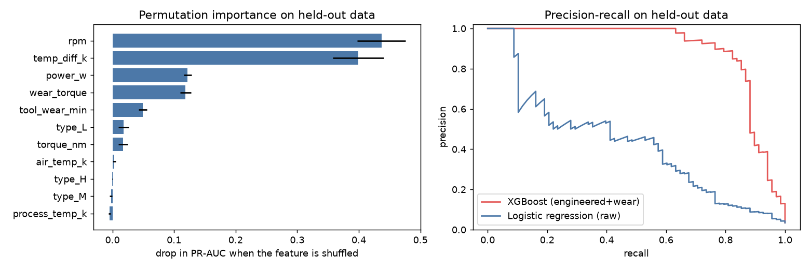
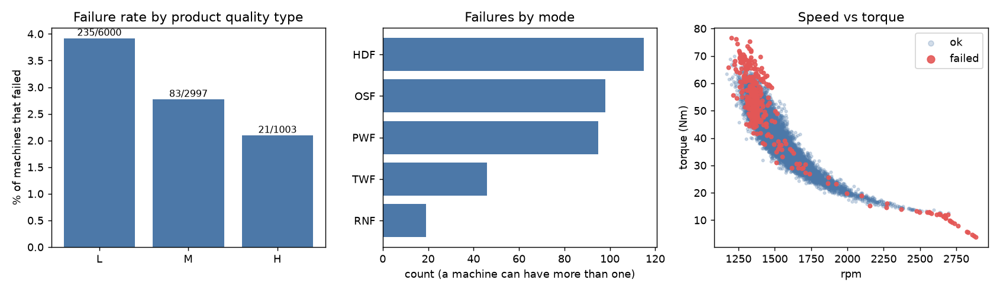

# Predictive Maintenance on AI4I 2020

Exploratory analysis and failure prediction on the UCI **AI4I 2020 Predictive Maintenance** dataset
(10,000 machine records, 339 failures). Pandas for the analysis, scikit-learn and XGBoost for the models,
and a set of Power BI-ready tables for the dashboard.



## Result

Held-out set: 2,000 machines, 68 of them failures (stratified 80/20 split, seed 42). Nothing on the held-out
part was used for tuning or for choosing the threshold.

| model | features | threshold | precision | recall | F1 | PR-AUC |
|---|---|---|---|---|---|---|
| **XGBoost** | raw + power + temp. difference + wear x torque | 0.39 (CV) | 0.887 | 0.809 | **0.846** | 0.893 |
| XGBoost | raw + power + temp. difference | 0.25 (CV) | 0.833 | 0.809 | 0.821 | 0.888 |
| XGBoost | raw only | 0.57 (CV) | 0.788 | 0.765 | 0.776 | 0.833 |
| Logistic regression | raw only | 0.50 | 0.636 | 0.103 | 0.177 | 0.422 |
| Logistic regression | raw only | 0.20 (CV) | 0.438 | 0.471 | 0.454 | 0.422 |
| Logistic regression | raw + power + temp. difference | 0.22 (CV) | 0.479 | 0.500 | 0.489 | 0.462 |

- The 95% bootstrap interval for the XGBoost F1 is 0.77 to 0.91; with 68 failures a single split is noisy.
- Repeating the entire protocol (split, tune, threshold, score) on 10 other random splits gives XGBoost F1
  **0.84 +/- 0.05** (range 0.75 to 0.89), against 0.28 +/- 0.03 for logistic regression at the default threshold
  and 0.49 to 0.50 +/- 0.04 for logistic regression with a tuned threshold.
- The logistic regression at 0.5 is a weak baseline mainly because only 3.4% of rows are failures, so it almost
  never predicts one. The tuned-threshold rows are the fairer comparison, and XGBoost still wins by a wide margin
  (paired bootstrap interval for the F1 difference against the tuned logistic regression: 0.27 to 0.46).
- Engineered features help XGBoost: raw 0.776 -> with power and temperature difference 0.821 -> with wear x torque
  0.846 on this split; on the 10 repeats raw XGBoost averages 0.76 against 0.84.

### Which failures it catches

| failure mode | in held-out set | caught |
|---|---|---|
| OSF (overstrain) | 16 | 16 |
| PWF (power) | 13 | 12 |
| HDF (heat dissipation) | 29 | 27 |
| TWF (tool wear) | 10 | 2 |
| RNF (random) | 4 | 0 |
| failure with no mode flag | 2 | 0 |

(A machine can have several modes, so rows do not add up to 68.) Random failures cannot be predicted by
construction, and tool-wear failures happen at a random point between 200 and 240 minutes of wear.

### What drives failures

Permutation importance on the held-out set (drop in PR-AUC when a feature is shuffled): `rpm` 0.44,
temperature difference 0.40, power 0.12, wear x torque 0.12, tool wear 0.05; everything else is close to zero.
Failures cluster at low speed and high torque (see the speed-vs-torque plot) and where process temperature is
close to air temperature.



## Read this before quoting the numbers

- **The data is synthetic.** The dataset description says so, and it also says how the failure modes are
  generated: HDF when the temperature difference is under 8.6 K and speed under 1,380 rpm, PWF when power is
  outside 3,500 to 9,000 W, OSF when tool wear x torque passes a limit that depends on quality type, TWF at a
  random wear value between 200 and 240 min, and RNF with 0.1% probability. Features such as power and
  wear x torque therefore recover the rules that created the labels. That explains the high scores and means
  they should not be read as what to expect on real machines.
- **Label quirks.** 9 rows have `Machine failure = 1` with no mode flag, and 18 rows have a mode flag (all RNF)
  with `Machine failure = 0`. They were left as they are.
- **No label leakage.** The five mode columns (`TWF`, `HDF`, `PWF`, `OSF`, `RNF`) are never used as inputs;
  a test checks that.
- **Small number of positives.** 271 failures to train on and 68 to evaluate, hence the repeated-split figures.

## Method

1. `src/data.py`: load, rename, derive `power_w` (torque x rpm x 2 pi / 60), `temp_diff_k`
   (process minus air temperature) and `wear_torque` (tool wear x torque), one-hot the quality type.
2. `src/experiment.py`: stratified 80/20 split; XGBoost hyperparameters by randomised search (40 draws, 5-fold CV,
   scored on average precision); decision threshold = F1-maximising threshold on out-of-fold training
   predictions; the feature set used for the headline row is the one with the best CV average precision.
   Logistic regression gets the same threshold treatment as an extra row.
3. `src/figures.py`: EDA and result plots. `src/powerbi_export.py`: tables for Power BI, with out-of-fold
   risk scores for every machine.

## Run it

```bash
python3 -m venv venv && source venv/bin/activate
pip install -r requirements.txt
python -m src.experiment --repeats 10   # about 6 minutes; writes reports/results.json
python -m src.figures
python -m src.powerbi_export
pytest
```

On macOS XGBoost needs the OpenMP runtime: `brew install libomp`. Without Homebrew, scikit-learn ships a copy:
`export DYLD_FALLBACK_LIBRARY_PATH=$(python -c "import sklearn,os;print(os.path.join(os.path.dirname(sklearn.__file__),'.dylibs'))")`.

## Power BI

`powerbi/` holds the tables, the DAX measures (`measures.dax`) and the steps to assemble the report.
The `.pbix` file is not included.

## Data

AI4I 2020 Predictive Maintenance Dataset, Stephan Matzka, UCI Machine Learning Repository, CC BY 4.0.
